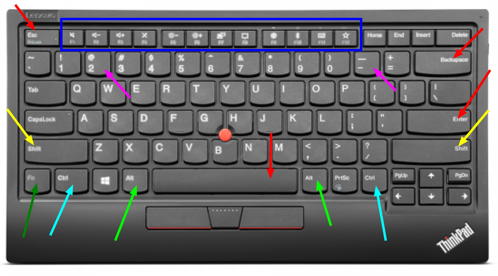

# Klawiatura

Klawiatura to przyciski pod ekranem. Jeden przycisk to klawisz.

Na zdjęciu jest laptop ThinkPad. Kolorowe strzałki pokazują klawisze z tej lekcji. Szukaj napisu na klawiszu. Na niektórych laptopach Fn i Ctrl są zamienione miejscami — czytaj napis, nie sam róg.

## Strzałki

- Strzałka CZERWONA wskazuje **Esc**. Lewy górny róg. Wychodzisz nim albo przerywasz.
- NIEBIESKI prostokąt wskazuje **blok klawiszy F (1–12)**. To górny rząd: F1, F2, F3, aż do F12. F to skrót od funkcja. To nie są litery do pisania.
- Strzałka CZERWONA wskazuje **Backspace**. Jest nad Enterem, po prawej stronie cyfr. Kasuje ostatni znak, ten przed kursorem. Kursor to migająca kreska w tekście.
- Strzałka CZERWONA wskazuje **Enter**. Duży klawisz po prawej stronie liter. Kończy linię. Po prawej jest jeszcze mały Enter przy cyfrach. Tego małego nie używaj.
- Strzałka ŻÓŁTA wskazuje **Shift**. Szeroki klawisz po lewej. Trzymasz go i naciskasz literę — wychodzi wielka litera. Jest też drugi po prawej. Używaj lewego.
- Strzałka CIEMNOZIELONA wskazuje **Fn**. Lewy dolny róg. Często ma niebieski napis. Niebieskie znaczki na bloku F działają tylko razem z Fn. Dziś ich nie potrzebujesz.
- Strzałka NIEBIESKA wskazuje **Ctrl**. Zaraz obok Fn. Sam nie pisze litery. Służy do skrótów.
- Strzałka JASNOZIELONA wskazuje **Alt**. Po klawiszu z okienkiem, tuż przed spacją. Też służy do skrótów.
- Strzałka CZERWONA wskazuje **spację**. Długi klawisz na dole, na środku. Nie ma na nim napisu. Robi odstęp między słowami.

## Caps Lock, Tab i okienko

Szukaj napisu albo znaczka na klawiszu.

- **Caps Lock**. Nad lewym Shiftem. Naciśniesz raz — litery wychodzą wielkie bez trzymania Shifta. Naciśniesz drugi raz — znowu są małe. Jeśli litery same robią się wielkie, naciśnij Caps Lock jeszcze raz.
- **Tab**. Nad Caps Lock, przed literą Q. Na klawiszu są dwie strzałki. W tekście robi większy odstęp niż spacja.
- **Klawisz ze znaczkiem Windows**. Między Ctrl a Alt. Znaczek wygląda jak okienko. Otwiera listę programów. Sam nie pisze litery. Dziś tylko go znajdź.

## Małpa i podłoga

Małpa to znak `@`. Podłoga to znak `_`. Przykłady zrobimy później.

- Małpa: przytrzymaj lewy Shift i naciśnij `2`. Dwójka jest nad literami, nie w bloku cyfr po prawej.
- Podłoga: przytrzymaj lewy Shift i naciśnij klawisz z kreską `-`. Jest obok zera, nad literą P.

## Skróty

Skrót to dwa klawisze naraz. Trzymasz pierwszy, stukasz drugi, puszczasz oba. Dziś tylko je poznajesz. Przykłady będą później.

- **Ctrl + C** — kopiuj. Tekst zostaje na miejscu. Kopia czeka.
- **Ctrl + V** — wklej. Czekająca kopia pojawia się przy kursorze.
- **Ctrl + X** — wytnij. Tekst znika z miejsca, ale kopia czeka. Potem można ją wkleić gdzie indziej.
- **Alt + F4** — zamknij okno. Alt to klawisz przy spacji, strzałka KOLOR. F4 to czwarty klawisz w bloku F: liczysz F1, F2, F3, F4. Nie myl Alt z Fn.
- **Alt + Tab** — przełącz okno. Trzymasz Alt i stukasz Tab. Na ekranie widać otwarte okna. Puszczasz Alt — zostajesz w oknie z jasną ramką. Okno się nie zamyka.

Jeśli okno nie znika, przytrzymaj też Fn: Alt, Fn i F4.
